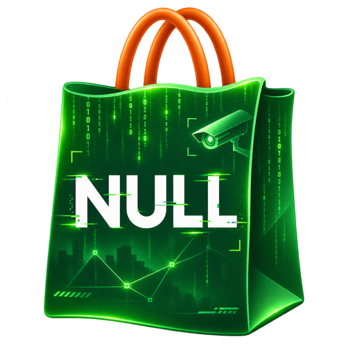
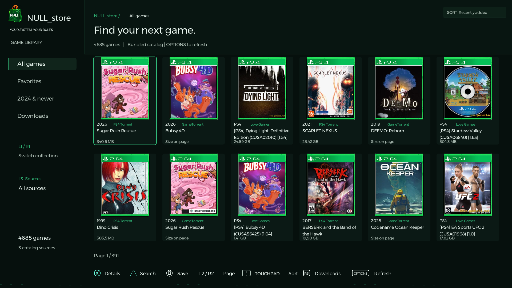
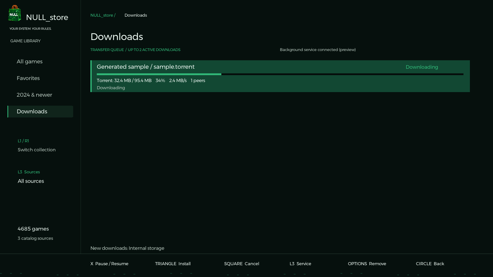
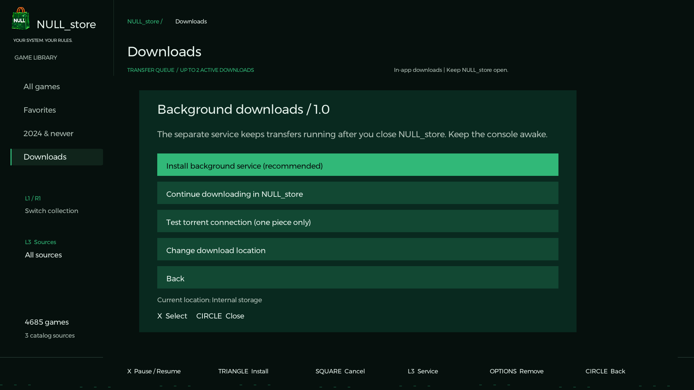

  
  <h1>NULL_store</h1>
  
<strong>PS4 homebrew game catalogue and BitTorrent download manager for HEN-enabled consoles.</strong>

  
Browse game listings, queue torrent downloads, install compatible PKG files, or keep transfers running with the optional background service.

  
YOUR SYSTEM. YOUR RULES.

  

    
    
    
    
  

## Watch NULL_store in action

[Watch the video on YouTube](https://www.youtube.com/watch?v=04Qp9h_wZIk).

> **Keep downloads running after you close NULL_store.** Install and start the optional Background Service, then confirm Downloads shows **Connected**. Transfers can continue after the store closes while the PS4 stays awake and HEN remains active. Without the connected service, keep NULL_store open. Rest mode is not supported.

## Install a downloaded package from NULL_store

When a torrent is complete, highlight it in **Downloads**, press **Triangle**, choose a compatible complete `.pkg`, and confirm. NULL_store starts and tracks the PS4's native install task. Check PS4 Notifications for the system result. The console may not provide a percentage, so the status can move from **Installing** to **Installed** without showing intermediate progress.

Only compatible, complete PKG files can be installed this way. Archives and split packages need to be extracted or joined first. Install a base game before its updates or DLC.

## Get started

1. Download and install the [NULL_store PKG](../../releases/latest/download/NULL_store-PS4-1.0.pkg) with HEN active.
2. Open **NULL_store** from the home screen. Browse the catalogue, search with **Triangle**, or save favorites with **Square**.
3. Open a listing and choose **Download** to add its torrent to the queue.
4. Press **R3** to open Downloads. Pause or resume jobs, choose a destination for new downloads, or use **Triangle** on a completed job to install a compatible PKG.

## Keep downloads running in the background

The main app downloads while it is open. For transfers to continue after you close it:

1. In NULL_store, open **Downloads**, press **L3**, and select **Start / Install service**.
2. Confirm the service shows **Connected** in Downloads.
3. Close NULL_store. The service can continue the transfer while the PS4 remains awake and HEN stays active.

You can also use the [optional Background Service PKG](../../releases/latest/download/NULL_store-Background-Service-1.0.pkg) to install or start the same service. Open the separate setup app and press **X**, then return to NULL_store and check for **Connected**.

The service does not download in rest mode or start automatically after a reboot. Reopen NULL_store after restarting the console.

## PS4 game catalogue and BitTorrent downloads

NULL_store starts with a bundled catalogue and refreshes public listing pages in the background. Press **Options** to refresh. Starting a download fetches the torrent from its source and contacts BitTorrent trackers to find peers. Peer availability depends on the torrent and your network, so some transfers may start slowly or find no usable peers.

Open **Downloads**, press **L3**, then choose **Test torrent connection (one piece only)** to test with the public-domain *Big Buck Bunny* torrent. It downloads one verified piece and stops at about 256 KB. [See the PS4 test guide.](TESTING.md)

## Known limitations and test status

- The same game or release may appear more than once because entries from different catalogue sources are kept separately.
- Transfers can be slow or fail when trackers are unavailable or no compatible peers can be reached.
- Package installation supports complete compatible `.pkg` files; it does not extract archives or join split packages.
- The Background Service requires HEN to remain active and the console to stay awake. Rest mode and automatic startup are not supported.
- PS4 may not report install percentages; check Notifications for the final system result.

Console testing has been performed on PS4 system software **13.00** with HEN active. The exact HEN/GoldHEN build was not recorded, and other firmware/HEN combinations have not been verified. Catalogue browsing, foreground transfers, and in-app PKG installation have been tried on-console. The Background Service's close-app behavior still needs further testing across console setups.

See the Downloads and Background Service screens

## Frequently asked questions

### Do I need to install the Background Service package separately?

You don't need another package to use NULL_store. The main app contains a service that can keep downloads running after the store closes. To try setting it up, go to **Downloads → L3 → Start / Install service**.

The separate Background Service PKG is optional. It provides another way to install or start the same service; you don't need it if setup works directly from NULL_store. Check that Downloads shows **Connected** and keep your PS4 awake with HEN active for background transfers.

## Disclaimer

NULL_store is a BitTorrent client for listings from third-party sites. This project publishes the app and its optional background service; it does not host, store, or distribute game files through this repository or a NULL_store server.

The app saves downloads on your PS4 and may upload pieces of those files to other BitTorrent peers during a transfer. Check your local laws and only download or share content you have permission to use.

## Source and building

The source code and host tests are available in this repository. See [BUILDING.md](BUILDING.md) for build requirements, [ROADMAP.md](ROADMAP.md) for planned improvements, and [CONTRIBUTING.md](CONTRIBUTING.md) to get involved. NULL_store is released under [GPL-3.0](LICENSE). Third-party components retain their respective licenses.

## Third-party software

The optional Background Service includes the unmodified `jb.prx` compatibility module from Itemzflow, licensed under GPL-3.0. The [license](https://github.com/LightningMods/Itemzflow/blob/e71c284c61db3fce53936178db30dd38be7ba47b/LICENSE), [PRX source and build files](https://github.com/LightningMods/Itemzflow/tree/e71c284c61db3fce53936178db30dd38be7ba47b/external/Jailbreak%20PRX), and [upstream module](https://github.com/LightningMods/Itemzflow/blob/e71c284c61db3fce53936178db30dd38be7ba47b/App-Media-Assets/Media/jb.prx) are available from the Itemzflow repository at the revision used for this component.

[Download checksums](SHA256SUMS.txt)
